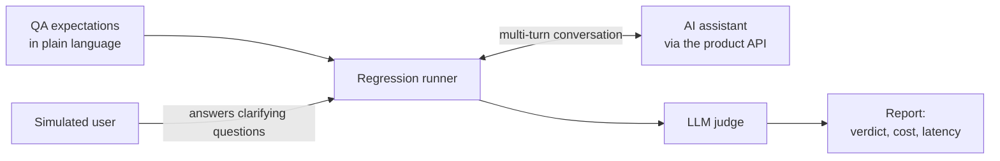

# Artem Dovhyi

### Senior Software & AI Product Engineer

**Web products · LLM features · AI evaluation**

---

I build the user-facing side of LLM features and the evaluation that shows they still work after the next change. The regression runner I built for AI assistants was adopted by six teams in about three months.

## 🧪 Featured work: a regression runner for AI assistants

AI assistant teams on an enterprise financial product couldn't tell whether a change had made their assistant worse across a real conversation. I designed and built the check they adopted.

- **The real product, not a prompt check.** The runner holds the whole conversation through the product's own API.
- **A simulated user** answers the assistant's clarifying questions, so the test reaches the answer.
- **An LLM judge** on AWS Bedrock scores the result against what QA expects.
- **Cost and latency on every run**, because every test is itself a set of LLM calls.
- **One engine, many teams.** Each assistant team keeps its own test suite.

| **6** | **about 3 months** | **about 90%** |
| :---: | :---: | :---: |
| AI assistant teams adopted it | from first implementation to adoption | agreement between the judge and QA review |

A QA engineer on my team saw the need. I took it from a proof of concept to the shared tool, and the technical implementation is mine.

## 🧱 Before that

5+ years of production React and TypeScript. On an enterprise advertising platform I created the shared UI library that four modules adopted, and covered the frontend lead role for four months across three subteams.

## 🛠️ Toolbox

**AI and LLM:** LLM evaluation · LLM-as-judge · multi-turn conversation testing · simulated users · cost, token and latency tracking · AI assistant UIs

**Frontend**

**Tooling and delivery**

**Quality**

## 🤝 Work with me

I'm looking for contract work with product teams shipping LLM features.

- 🌏 Remote, UTC+7. Live overlap with Sydney morning, EU afternoon, and US East late morning.
- 🧾 Contracting through Temorix LLC, a US company. USD invoicing, B2B contract.
- 📬 [artem@temorix.com](mailto:artem@temorix.com) · [LinkedIn](https://www.linkedin.com/in/artem-dovhyi) · [temorix.com](https://temorix.com)
